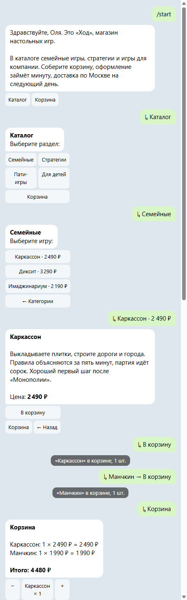
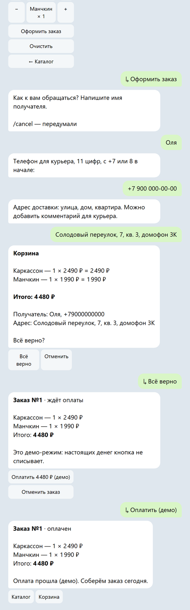

# tg-shop-bot

Telegram shop bot on aiogram 3 and SQLite: catalog, cart, checkout, admin notifications and a demo payment mode.

Бот магазина настольных игр «Ход». Покупатель листает каталог, собирает корзину, оформляет заказ и оплачивает его в демо-режиме. Администратор получает заказ в личные сообщения и меняет статус кнопкой, а покупателю приходит уведомление. Корзина и заказы лежат в SQLite и переживают перезапуск.

[](https://github.com/hmsusbusas-png/tg-shop-bot/actions/workflows/tests.yml)
[](LICENSE)

<p>


</p>

Переписка снята не с телефона: `scripts/dialog.py` прогоняет сценарий через настоящие хендлеры бота без Telegram и рисует ответы в HTML. Тексты, кнопки и всплывающие подсказки — ровно то, что бот отправил бы в чат.

## Возможности

- Каталог по разделам, карточка товара, корзина с кнопками «−» и «+» (не больше 20 штук одного товара).
- Оформление в четыре шага: имя, телефон (любой формат, приводится к `+7XXXXXXXXXX`), адрес, подтверждение. `/cancel` прерывает оформление, корзина остаётся.
- Демо-оплата: кнопка «Оплатить (демо)» переводит заказ в «оплачен», настоящих денег нет. С `DEMO_PAYMENTS=0` кнопки нет, заказ сразу уходит менеджеру.
- Администраторы из `ADMIN_IDS` получают заказ с контактами и кнопками «Передан в доставку» и «Отменить», покупатель получает уведомление.
- `/orders` — последние заказы покупателя, `/stats` и `/all_orders` — только для администраторов.

## Безопасность

- Всё, что пишет пользователь (имя, телефон, адрес, даже имя в профиле Telegram), экранируется перед отправкой в HTML-режиме.
- SQL только с параметрами.
- Действия администратора проверяют id. Попытка не-админа записывается в лог.
- Оплатить или отменить заказ может только его владелец. Статус меняется только из ожидаемого состояния, поэтому двойное нажатие не оплатит и не уведомит дважды.
- Корзина и callback data проверяются по базе: несуществующий товар или раздел даёт сообщение, а не исключение.

## Как запустить

Нужен Python 3.11+ и [uv](https://docs.astral.sh/uv/). Токен бота выдаёт [@BotFather](https://t.me/BotFather), свой числовой id покажет [@userinfobot](https://t.me/userinfobot).

```sh
git clone https://github.com/hmsusbusas-png/tg-shop-bot
cd tg-shop-bot
uv sync
cp .env.example .env        # в PowerShell: copy .env.example .env
# впишите BOT_TOKEN и ADMIN_IDS в .env
uv run shopbot
```

Без токена бот не запускается и объясняет, что сделать. С неверным токеном пишет, что Telegram его не принял.

В Docker:

```sh
docker build -t shopbot .
docker run -d --name shopbot --restart unless-stopped --env-file .env -v shopbot-data:/data shopbot
```

## Как устроено

```
src/shopbot/
  main.py          запуск, сборка Dispatcher, понятные ошибки токена и сети
  config.py        .env и проверка значений
  db.py            SQLite: каталог, корзина, заказы, статусы
  keyboards.py     inline-клавиатуры и CallbackData
  handlers/
    shop.py        приветствие, каталог, корзина
    orders.py      оформление (FSM), демо-оплата, /orders
    admin.py       уведомления, смена статуса, /stats
```

Магазин и настройки передаются в хендлеры через данные диспетчера, поэтому в тестах их легко подменить.

Тесты (`uv run pytest`, 18 штук) кормят настоящий `Dispatcher` апдейтами, а Bot API заменён сессией, которая отвечает локально и запоминает вызовы. Проверяются фильтры, FSM, тексты и права целиком: от `/start` до оплаты и смены статуса администратором. CI гоняет ruff, mypy и pytest.

## Ограничения

- Состояние оформления хранится в памяти (`MemoryStorage`): если перезапустить бота посреди оформления, его придётся начать заново. Корзина при этом сохраняется. Для нескольких копий бота нужен `RedisStorage`.
- Настоящей оплаты нет. Для неё подключаются Telegram Payments или ЮKassa, а демо-кнопка заменяется на `send_invoice`.
- Каталог задаётся в `db.py` и заполняется при первом запуске. Админки для правки товаров нет.

## Лицензия

MIT, см. [LICENSE](LICENSE).
